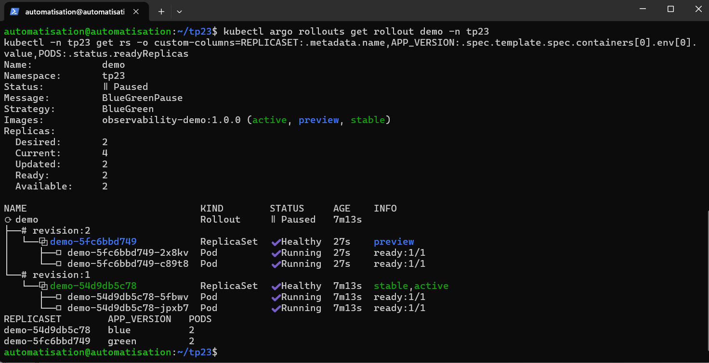
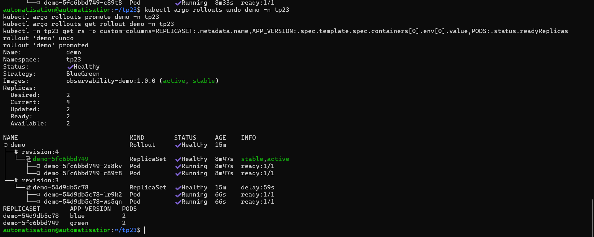
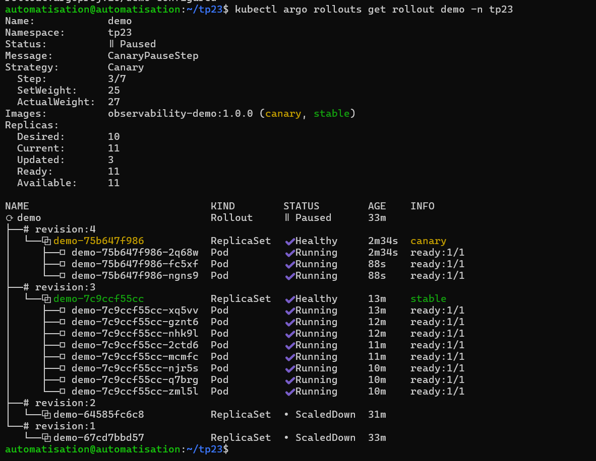
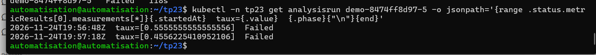
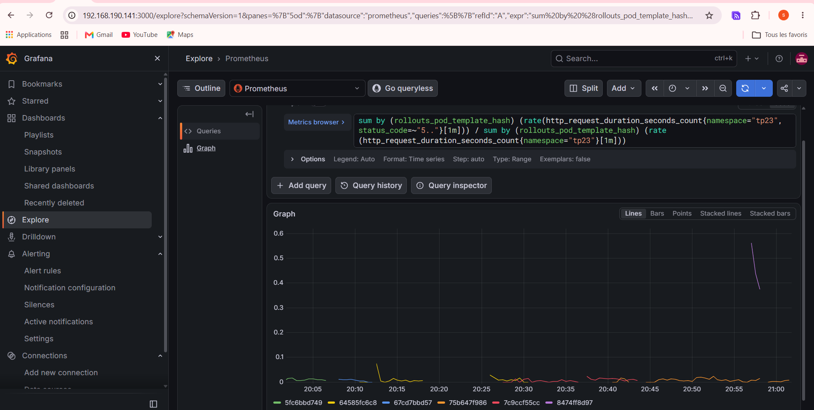
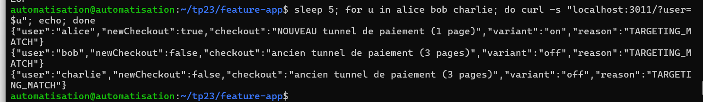

# TP23 : Progressive Delivery (Argo Rollouts, Blue/Green, Canary, analyse, Feature Flags)

Mise en production progressive d'une application sur K3s avec **Argo Rollouts** (Blue/Green, Canary, analyse Prometheus et rollback automatique), puis séparation du **déploiement** et de la **release** avec des **Feature Flags** (OpenFeature + flagd).

## Environnement

- VM Ubuntu 26.04 avec K3s v1.36
- Argo Rollouts v1.10.2 (contrôleur et plugin `kubectl argo rollouts`)
- Prometheus et Grafana du TP21 (release Helm `kps`)
- Image `observability-demo:1.0.0` du TP21, importée dans K3s

## Structure

```
tp23/
├── rollouts/
│   ├── 00-namespace-svc.yaml        namespace tp23, Services demo-active / demo-preview, ServiceMonitor
│   ├── 10-rollout-bluegreen.yaml    Rollout Blue/Green (scaleDownDelaySeconds: 60)
│   ├── 20-analysis-template.yaml    AnalysisTemplate error-rate (PromQL, successCondition: result[0] < 0.05)
│   └── 30-rollout-canary.yaml       Rollout Canary 10/25/50/100 % avec analyse en arrière-plan
├── feature-app/
│   ├── server.js                    OpenFeature + provider flagd, évaluation du flag new-checkout
│   ├── flags/flags.json             définition du flag (ciblage de l'utilisatrice alice)
│   ├── Dockerfile
│   └── docker-compose.yml           flagd + application
├── reponses.md                      réponses aux questions et résultats
└── captures/                        captures d'écran
```

## Commandes principales

```bash
# Partie 1 : préparation
kubectl apply -f rollouts/00-namespace-svc.yaml
kubectl -n tp23 run load --image=busybox:1.37 --restart=Never -- sh -c \
  'while true; do wget -qO- http://demo-active/api/orders >/dev/null 2>&1; sleep 0.1; done'

# Partie 2 : Blue/Green
kubectl apply -f rollouts/10-rollout-bluegreen.yaml
kubectl argo rollouts get rollout demo -n tp23
kubectl argo rollouts promote demo -n tp23
kubectl argo rollouts undo demo -n tp23

# Partie 3 : Canary
kubectl apply -f rollouts/30-rollout-canary.yaml
kubectl argo rollouts abort demo -n tp23
kubectl argo rollouts retry rollout demo -n tp23

# Partie 4 : analyse et rollback automatique
kubectl apply -f rollouts/20-analysis-template.yaml
kubectl -n tp23 get analysisrun

# Partie 5 : Feature Flags
cd feature-app && docker compose up -d --build
curl -s "localhost:3011/?user=alice"
```

> Le port 3001 étant déjà utilisé par mon portfolio (TP1), la feature-app est exposée sur **3011**.

## Résultats principaux

- **Blue/Green** : le retour arrière est instantané pendant 60 s, car l'ancienne version reste démarrée et seul le sélecteur du Service change.
- **Canary** : la progression se fait par paliers. Sans routeur de trafic, le poids est approché par le nombre de Pods (`ActualWeight 27` = 3 Pods sur 11).
- **Analyse** : la version v3 (50 % d'erreurs) a été détectée par Prometheus et annulée automatiquement en environ 1 minute. Environ 25 requêtes ont été affectées, contre environ 300 erreurs par minute avec un Deployment classique.
- **Feature Flags** : la fonctionnalité s'active sans redéploiement, pour tout le monde, pour un seul utilisateur, ou pour 20 % des utilisateurs, avec une attribution stable.

Le détail est dans [reponses.md](reponses.md).

---

## Captures d'écran

### Blue/Green : Rollout en pause, preview sur green et active sur blue


### Blue/Green : retour arrière instantané


### Canary : progression palier par palier


### Analyse : AnalysisRun en échec et rollback automatique


### Grafana : pic du taux d'erreur limité dans le temps


### Feature Flags : réponses différentes pour alice et pour les autres utilisateurs

